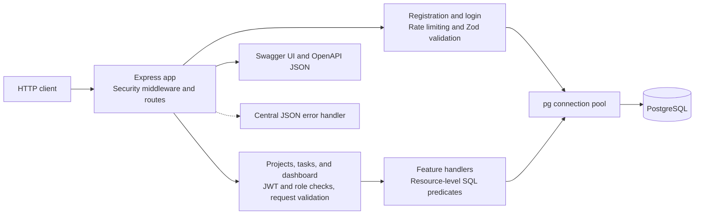
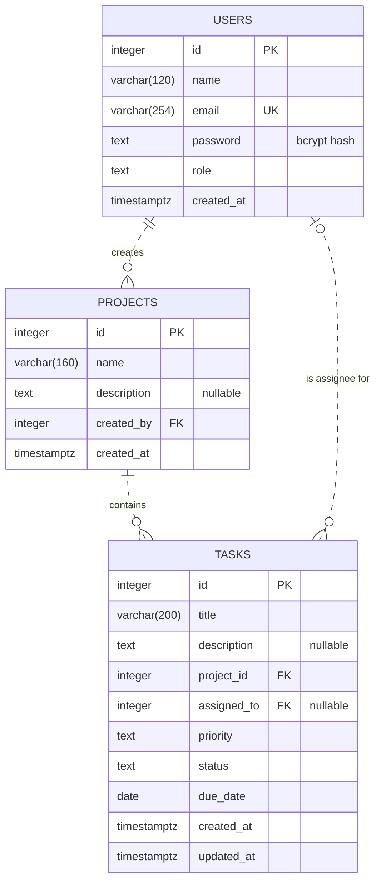

# Task Management & Team Collaboration API

A REST API for managing projects, assigning tasks, and tracking team progress. Built for the Graphketing backend assessment, it uses Express and PostgreSQL to enforce project ownership and task-level permissions across 13 endpoints.


## Table of contents

- [Key features](#key-features)
- [Quick start with Docker](#quick-start-with-docker)
- [Local setup](#local-setup)
- [Architecture and project structure](#architecture-and-project-structure)
- [Database schema](#database-schema)
- [API reference](#api-reference)
- [Authentication and authorization](#authentication-and-authorization)
- [Testing and verification](#testing-and-verification)
- [Documentation](#documentation)
- [Known limitations and optional features](#known-limitations-and-optional-features)

## Key features

- **Projects and tasks.** Create projects, assign tasks to registered users, and track priority, due dates, and completion.
- **Resource-level permissions.** Admins have global access. User access follows project ownership and task assignment, including status-only updates for assignees.
- **Search and reporting.** Combine title search, project, assignee, status, and priority filters with pagination. Dashboard totals reflect the caller’s access.
- **API discovery.** Swagger UI and the Postman collection include all 13 assessment endpoints.

The API uses Node.js ES modules, Express 5, the `pg` PostgreSQL driver, Zod validation, bcrypt password hashing, and JWT bearer authentication. Jest and Supertest exercise the HTTP API against PostgreSQL.

## Quick start with Docker

Install Docker with the Compose plugin and clone the [Graphketing-Assignment repository](https://github.com/CrysPy-SAM/Graphketing-Assignment).

```sh
git clone https://github.com/CrysPy-SAM/Graphketing-Assignment.git
cd Graphketing-Assignment
cp .env.example .env
```

In PowerShell, use `Copy-Item .env.example .env` for the copy step. In the ignored `.env` file, uncomment and set `POSTGRES_PASSWORD` and set `JWT_SECRET` to a separate random value of at least 32 characters.

```sh
docker compose up --build
```

Compose waits for PostgreSQL, initializes the schema, and checks API readiness. Open [Swagger UI](http://localhost:5000/api-docs/) at the default port and use **Try it out** to register, log in, and create a project. The API binds to `127.0.0.1` at the configured host port, and PostgreSQL stays on the Compose network. The named volume preserves database data across `docker compose down` and subsequent startup.

## Local setup

Install Node.js 22+, npm, and PostgreSQL 16 or newer. From a PostgreSQL administrator session in `psql`, create the application role and separate application and test databases.

```sql
CREATE ROLE task_api LOGIN;
\password task_api
CREATE DATABASE task_management OWNER task_api;
CREATE DATABASE task_management_test OWNER task_api;
```

Copy `.env.example` to `.env`. Set `DATABASE_URL` to the application database using the new role, and URL-encode the password if it contains URI delimiters. Generate a private signing secret and set `JWT_SECRET` to the output.

```sh
node -e "console.log(require('node:crypto').randomBytes(32).toString('hex'))"
```

Install dependencies, initialize the database, and start the server.

```sh
npm ci
npm run db:init
npm start
```

The initializer runs in a transaction under an advisory lock and can be rerun without clearing data.

### Environment variables

| Variable | Purpose |
| --- | --- |
| `DATABASE_URL` | Local PostgreSQL connection URL. Compose supplies `PGHOST`, `PGPORT`, `PGUSER`, `PGDATABASE`, and `PGPASSWORD` instead. |
| `JWT_SECRET` | Private signing secret of at least 32 characters. |
| `JWT_EXPIRES_IN` | Token lifetime. Defaults to `1d`. Use a positive value with `s`, `m`, `h`, or `d`. |
| `PORT`, `NODE_ENV` | HTTP port (default `5000`) and runtime environment. |
| `CORS_ORIGINS` | Comma-separated browser origins, such as `http://localhost:5173`. An empty value permits same-origin use only. |
| `TEST_DATABASE_URL` | Dedicated PostgreSQL test database URL. The database role needs permission to create schemas. |
| `POSTGRES_PASSWORD` | Password for the PostgreSQL container in Compose. |

## Architecture and project structure



`src/server.js` checks the database schema before accepting connections. `src/config.js` validates configuration and creates the connection pool. Express 5 forwards rejected async handlers to the central JSON error handler in `src/http.js`.

```text
Graphketing-Assignment/
├── database/
│   └── schema.sql
├── docs/
│   ├── CHECKLIST.md
│   ├── api-evidence.json
│   └── task-management.postman_collection.json
├── scripts/
│   ├── capture-evidence.js
│   ├── create-admin.js
│   ├── init-db.js
│   └── run-init.js
├── src/
│   ├── app.js
│   ├── auth.js
│   ├── config.js
│   ├── dashboard.js
│   ├── http.js
│   ├── openapi.js
│   ├── projects.js
│   ├── server.js
│   ├── tasks.js
│   └── validation.js
├── tests/
│   └── api.test.js
├── .dockerignore
├── .env.example
├── .gitignore
├── Dockerfile
├── docker-compose.yml
├── package-lock.json
├── package.json
└── README.md
```

## Database schema



Each project has one creator, and each task belongs to one project with an optional assignee. Email addresses are normalized and unique. Deleting a project cascades to its tasks. The database restricts deletion of a creator with existing projects and clears task assignments when an assignee is deleted. A trigger maintains `updated_at` even for changes made outside the API. [PostgreSQL schema](database/schema.sql)

## API reference

The default base URL is `http://localhost:5000`. Registration and login are public. Project, task, and dashboard endpoints require a bearer token.

### Authentication

| Method | Endpoint | Purpose |
| --- | --- | --- |
| `POST` | `/api/auth/register` | Register a User |
| `POST` | `/api/auth/login` | Obtain a JWT access token |

### Projects

| Method | Endpoint | Purpose |
| --- | --- | --- |
| `GET` | `/api/projects` | List visible projects |
| `POST` | `/api/projects` | Create a project |
| `GET` | `/api/projects/:id` | Read a visible project |
| `PUT` | `/api/projects/:id` | Update a project |
| `DELETE` | `/api/projects/:id` | Delete a project and its tasks |

### Tasks and dashboard

| Method | Endpoint | Purpose |
| --- | --- | --- |
| `GET` | `/api/tasks` | Search, filter, and paginate visible tasks |
| `POST` | `/api/tasks` | Create a task with a project and due date |
| `GET` | `/api/tasks/:id` | Read a visible task |
| `PUT` | `/api/tasks/:id` | Update a task |
| `DELETE` | `/api/tasks/:id` | Delete a task |
| `GET` | `/api/dashboard/stats` | Read project, task, status, and personal assignment counts |

### Task filters and updates

```text
GET /api/tasks?search=backend&status=In%20Progress&priority=High&project_id=1&assigned_to=2&page=1&limit=10
```

Filters combine with AND. Search matches a case-insensitive literal substring of the title. Results sort by descending ID and default to page 1 with 10 records, with a maximum of 100 per page. Responses include `pagination.total`, `pagination.page`, `pagination.limit`, and `pagination.totalPages`. A valid page beyond the last returns an empty array and retains the count.

Priorities are Low, Medium, and High. Statuses are Pending, In Progress, and Completed. Due dates use `YYYY-MM-DD`. The `PUT` endpoints apply supplied fields and require at least one. A task stays in its original project. Use `null` to clear a project description, task description, or task assignment.

## Authentication and authorization

1. Register with `name`, `email`, and `password`. Public registration creates a User.
2. Log in with `email` and `password` to receive `data.accessToken`.
3. Send `Authorization: Bearer <token>` on protected requests, or paste the token into Swagger’s **Authorize** dialog.

Project creator and task assignee are resource relationships that grant access within the User role.

| Action | Admin | Project creator | Task assignee | Other User |
| --- | --- | --- | --- | --- |
| Create a project | Yes | Yes | Yes | Yes |
| Read a project | All | Own | Projects containing assigned tasks | No |
| Update or delete a project | All | Own | No | No |
| Read a task | All | In own projects | Own assignments | No |
| Create or delete a task | All | In own projects | No | No |
| Update a task | All fields allowed by schema | In own projects | Status only | No |
| View dashboard | Global totals | Visible resources | Visible resources | Visible resources |

Hidden resources return HTTP `404`. A write to a visible resource without the required permission returns HTTP `403`. The dashboard’s personal assignment count refers to the caller, including for Admins.

### Provision an Admin

Temporarily set `ADMIN_NAME`, `ADMIN_EMAIL`, and `ADMIN_PASSWORD` in the ignored `.env` file, run `npm run admin:create`, then remove the variables. The command requires an unused email and stores a bcrypt hash.

With Compose, set the variables in the invoking shell and pass them through to the API container.

```sh
docker compose exec -e ADMIN_NAME -e ADMIN_EMAIL -e ADMIN_PASSWORD api npm run admin:create
```

### Security controls

The API hashes passwords with bcrypt, verifies JWTs, and marks login responses `Cache-Control: no-store`. Helmet, a CORS allowlist, a 16 KB JSON body limit, and authentication rate limiting protect requests. SQL uses bound values, and strict request schemas restrict writable columns so clients cannot supply roles, owners, or timestamps. Resource access predicates apply before counting and pagination.

## Testing and verification

Uncomment and set `TEST_DATABASE_URL` in `.env` to the dedicated test database.

```sh
npm test
```

The Jest suite uses Supertest against Express and real PostgreSQL. Each run creates and drops its own randomly named schema.

| Check | Verified result |
| --- | --- |
| Fresh-clone integration suite | 16 tests passed on PostgreSQL 16.16 |
| Live HTTP verification | The local API and Docker Compose each completed 18 requests covering all 13 required endpoints |
| Postman collection | 13 expected-status assertions passed in Newman |

To reproduce the live HTTP evidence, start the API against a disposable database, optionally set `API_BASE_URL` to its local URL, and run `npm run evidence`. The script registers disposable accounts, creates and removes a project, and records sanitized HTTP exchanges. To capture screenshots, repeat the requests in Swagger UI and crop any credentials or bearer tokens before saving the images.

## Documentation

| Resource | What it covers |
| --- | --- |
| [Swagger UI](http://localhost:5000/api-docs/) and [OpenAPI JSON](http://localhost:5000/api-docs.json) | Interactive endpoint reference and the generated specification on a running local instance |
| [Postman collection](docs/task-management.postman_collection.json) | All 13 operations in runnable order |
| [Compliance report](docs/CHECKLIST.md) | Assessment requirements, implementation coverage, and verification results |
| [Sanitized HTTP evidence](docs/api-evidence.json) | Recorded Docker Compose API exchanges |
| [Archived interview guide](https://github.com/CrysPy-SAM/Graphketing-Assignment/blob/1d9fe2cc0270a7294b71c395708aa3598027b203/docs/INTERVIEW_GUIDE.md) | Interview notes from the original audited snapshot |

For a full Postman run against a disposable instance, set `baseUrl`, `email`, and `password` in a local environment. Use an unused email and a password of at least eight characters and at most 72 UTF-8 bytes. Login and creation requests populate the bearer token and resource IDs. The final requests remove the created task and project.

## Known limitations and optional features

All mandatory assessment features are implemented. Docker Compose, Swagger UI, and integration tests are included as assessment bonuses.

- Users log in again when a JWT expires. Refresh tokens are outside the current scope.
- Deletion is permanent. Task activity logs and soft deletion are outside the current scope.
- The in-memory IP rate limiter tracks requests independently per API process.
- Docker Compose serves HTTP on the local machine.
- Offset pagination is deterministic for a fixed result set. Concurrent inserts can shift records between pages.
